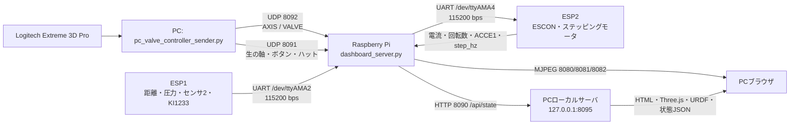

# 配管ロボット操縦・リアルタイム表示システム

更新日: 2026-07-29

この資料は、現在の本番用PCランチャーを基準に、コントローラ操作、速度制御、Raspberry Pi/ESP32間の通信、センサ表示、URDFを使った3D状態表示を共有するためのものです。過去の実験メモと内容が異なる場合は、本資料と実装コードを優先してください。

## システム構成



現在の電磁弁は `dashboard_server.py` がUDP 8092の `VALVE` 指令を受け、Raspberry Pi GPIOで直接駆動します。`AXIS` などのモータ指令はESP2へUART転送します。ESP2にも350 msウォッチドッグ付き電磁弁処理は残っていますが、現行Pi設定ではESP2側の電磁弁GPIOは未割り当てです。

## 起動と停止

有線LANを標準とします。

```powershell
.\raspi_tools\start_pc_experiment_launcher.ps1 -PiHost 192.168.0.218
```

Wi-Fiを使用する場合:

```powershell
.\raspi_tools\start_pc_experiment_launcher.ps1 -PiHost 192.168.50.154
```

ランチャーは次をまとめて行います。

1. `127.0.0.1:8095` でPCローカルダッシュボードを起動
2. Piの `http://<Pi>:8090/api/state` をPCローカルへ中継
3. `?cad=1` 付きの監視画面をブラウザで開く
4. コントローラ送信プロセスを起動
5. 終了時に `ABS_X=512`、`ABS_Y=512`、`VALVE,ALL,0` を複数回送信

停止は、起動したPowerShellで `Ctrl+C` を押します。緊急時や別端末からの停止:

```powershell
.\raspi_tools\stop_robot_operation.ps1 -StopPcSender
```

Piの電源が入っていない場合でもPCローカル画面は開きますが、状態API、カメラ、操縦はオフラインです。

## 現在のコントローラ割り当て

`start_pc_experiment_launcher.ps1` の本番設定です。

| 入力 | 動作 | 指令・方式 |
|---|---|---|
| 軸0 左右 | ステッピングモータ方向・速度 | `AXIS,ABS_X,0..1023` |
| 軸1 前後 | DCモータ正転・逆転の選択 | 軸3の速度と組み合わせて `ABS_Y` を生成 |
| 軸3 | DCモータ通常速度 | 0～設定上限を連続調整、符号反転設定あり |
| ハット0 上下 | DCモータ専用最高速 | 正転・逆転、軸3の通常速度上限を使用しない |
| ボタン7 | ドリル押し出し | 押している間だけON |
| ボタン6 | ドリル引き込み | 押している間だけON |
| ボタン9 | 走行輪押し付け | 押している間だけON |
| ボタン8 | 走行輪引き込み | 押している間だけON |
| ボタン10 | グラインダ空圧ON | トグルON |
| ボタン11 | グラインダ空圧OFF | トグルOFF |

通常運転では圧力フィードバック制御を行いません。ロール位置変更時だけ次で起動すると、ドリル押し出し要求中に0.60 MPaを上限としてON/OFF制御します。

```powershell
.\raspi_tools\start_pc_experiment_launcher.ps1 -RollPositionChangeMode
```

下限は0.58 MPa、上限は0.60 MPaです。圧力値が不正または0.5秒以上古い場合、押し出しをOFFにします。

## DCモータ速度制御

通常速度と専用最高速を分離しています。これは、実機で一度最高速域へ入った後に軸3を戻しても速度が下がりにくかった問題を避け、低中速の調整幅を確保するためです。

本番パラメータ:

```text
direction axis       = 1
throttle axis        = 3
deadzone             = 0.18
throttle full scale  = 0.95
normal max duty      = 0.20
response exponent    = 1.0（線形）
full-speed hat       = 0
```

軸3を符号反転した後の値を `t` とすると、通常速度比は概ね次です。

```text
r = clamp((t + 1) / (0.95 + 1), 0, 1)
normal_duty_ratio = 0.20 * r
```

PCはESP32側の50カウント不感帯を補償して `ABS_Y` を生成します。ESP32は0～255のモータ指令へ変換し、さらに実機校正した3区間のPWM-DAC特性へ変換します。

| ESP32モータ指令 | PWM出力（11 bit、0～2047） | 用途 |
|---:|---:|---|
| 0 | 0 | 停止、ESCON ENABLE OFF |
| 200 | 253 | 低中速域の終端 |
| 250 | 318 | 飽和直前 |
| 255 | 420 | 専用最高速 |

通常の軸3操作はPC側でモータ指令約51相当までに制限されます。ハット0だけが最大指令を使用します。これは回転数の閉ループ制御ではなく、ESCONへの速度指令値を調整する開ループ操作です。実速度は `rpm` / `encoder_rpm` で監視します。

起動直後の誤動作防止として、軸3を一度最低位置まで戻すまでDCモータ出力を許可しないインターロックがあります。

## 通信と安全仕様

| 経路 | 内容 | 周期・条件 |
|---|---|---|
| PC → Pi UDP 8092 | `AXIS`、`VALVE` | 基本20 Hz、軸指令は50 ms以内で再送 |
| PC → Pi UDP 8091 | コントローラ生入力JSON | 20 Hz、画面表示専用 |
| Pi ↔ ESP1 | センサ1系テレメトリ | `/dev/ttyAMA2`, 115200 bps |
| Pi ↔ ESP2 | モータ指令・テレメトリ | `/dev/ttyAMA4`, 115200 bps |
| Pi → PC HTTP 8090 | `/api/state` | ブラウザは250 ms周期で取得 |
| Pi → PC MJPEG | カメラ3台 | 8080～8082、標準320×240、5 fps |

安全処理:

- PC終了時にモータ中立と全電磁弁OFFを送信
- 電磁弁ON中はPCが50 msごとに保持指令を再送
- Pi側で350 ms更新が途切れた電磁弁を自動OFF
- 押し出しと引き込みは同時ON禁止
- DCモータ指令0でESCON ENABLEをOFFし、PWM指令を0 Vへ戻す
- 通信断、Pi停止、コントローラ送信の二重起動を画面と端末で確認する

## `/api/state` の主な内容

`dashboard_server.py` がESP1、ESP2、コントローラ、Pi GPIO状態を1つのJSONへ集約します。

| JSONセクション | 主な値 |
|---|---|
| `imu` | センサ2加速度、roll/pitch、更新時刻 |
| `body_accel` | 移動体側センサ1加速度、roll/pitch、更新時刻 |
| `sensors` | 距離、圧力、KI1233信号、グラインダ回転数 |
| `motor` | duty、PWM出力、enable、ESCON速度、エンコーダ速度、電流、step_hz、ACCE1 |
| `valves` | 走行輪・ドリル・グラインダの論理ON/OFF |
| `controller` | 軸、ボタン、ハット、送信元、シーケンス番号 |
| `ports` | シリアル、UDP、GPIOの状態と更新時刻 |

直接確認:

```powershell
Invoke-RestMethod http://192.168.0.218:8090/api/state |
  ConvertTo-Json -Depth 8
```

## 3DモデルとURDF

ブラウザのThree.jsがPC側で描画するため、Raspberry Piに3Dレンダリング負荷はかかりません。Piは状態JSONとカメラ映像だけを配信します。

モデルの読み込み優先順位:

1. `robot_model.stl` とコンポーネントマップによる検証済みFusion配置
2. ACDC4Robotで出力したURDFと分割STL
3. 旧CAD表示
4. 軽量な手続き型モデル

GitHubにはURDF、分割メッシュ、検証済み一体Fusion STL、三角形とモジュールの対応表を含めています。一体STLが利用できない場合でも、自動的にURDFメッシュへフォールバックします。

現在の配管内径は240 mmです。配管中心軸は回転9軸から半径方向へ `-5.5 mm` の位置として描画します。

### 表示ジョイント

| 画面上の軸 | 対象リンク | 表示値の根拠 | 性質 |
|---|---|---|---|
| ロボット全体roll | 全リンク | センサ1の起動時基準に対する相対roll | センサ由来 |
| `slider6` | `motor_module-v1` | 走行輪押し付け/引き込み電磁弁状態 | 指令からの見た目推定 |
| `rotation9` | `drilling_module1-v1` 以下 | センサ2 roll − センサ1 roll − ゼロ補正 | センサ由来 |
| `slider11` | `drilling_module2-v1` 以下 | 距離センサの基準値との差。距離増加で上昇 | センサ由来、中央値・平滑化あり |
| `rotation12` | `bit-v1` | 工具回転検出に応じた表示位相 | 表示用 |

`slider6` は位置センサを持たないため実位置保証はありません。`slider11` も距離センサの取付け、反射状態、基準取得、1.5 mmデッドバンド、平滑化の影響を受けます。IMU表示は加速度だけを使うため、振動や並進加速度があると重力方向推定が乱れます。

### ジョイント調整

Piなしで設定画面を起動できます。

```powershell
.\raspi_tools\start_robot_model_joint_editor.ps1
```

```text
http://127.0.0.1:8095/robot_model_joint_editor.html
```

設定は `raspi_tools/camera_stream/robot_model_config.json` へ保存されます。Fusion 360のジョイント情報を書き出すアドインは `raspi_tools/fusion_joint_exporter/` にあります。

## オフライン動作確認

PCだけでダッシュボードを起動:

```powershell
python .\raspi_tools\pc_experiment_launcher.py `
  --pi-host 192.168.0.218 `
  --no-controller `
  --no-browser
```

ブラウザで次を開き、「センサ入力テスト」を選択します。

```text
http://127.0.0.1:8095/robot_dashboard.html?pi=192.168.0.218&cad=1&demo=1
```

このモードではスライダと回転軸の動きを手動で確認できます。実機へ指令は送りません。

## 関連ファイル

| ファイル | 役割 |
|---|---|
| `start_pc_experiment_launcher.ps1` | 本番パラメータを固定した起動入口 |
| `pc_experiment_launcher.py` | PCローカルHTTPサーバ、Pi API中継、送信プロセス管理、安全停止 |
| `pc_valve_controller_sender.py` | pygame入力、速度変換、UDP 8091/8092送信 |
| `camera_stream/dashboard_server.py` | Pi上のシリアル・UDP・GPIO・HTTP集約 |
| `camera_stream/robot_dashboard.html` | カメラ、センサ、警告、Three.js/URDF表示 |
| `camera_stream/robot_model_config.json` | モジュール初期配置とジョイント軸・範囲 |
| `camera_stream/assets/robot_model_pipe_urdf2/` | URDFと共有用分割メッシュ |
| `camera_stream/README_MODEL_ASSETS.md` | Fusion/URDF/STL資産の更新方法 |
| `esp32_escon_telemetry/src/` | ESP2本番ファームウェア |

## 制約

- 表示された3D姿勢やスライダ位置を安全停止、接触判定、加工深さ保証には使用しない
- RPMと電流はESCON設定およびADC校正値に依存する
- Wi-Fi IPを使うにはPCとPiが同一サブネットにいる必要がある
- PCコントローラ送信プログラムを二重起動しない
- 実験前に中立、回転方向、電磁弁の実動作、非常停止方法を確認する
