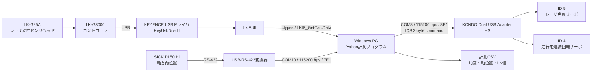
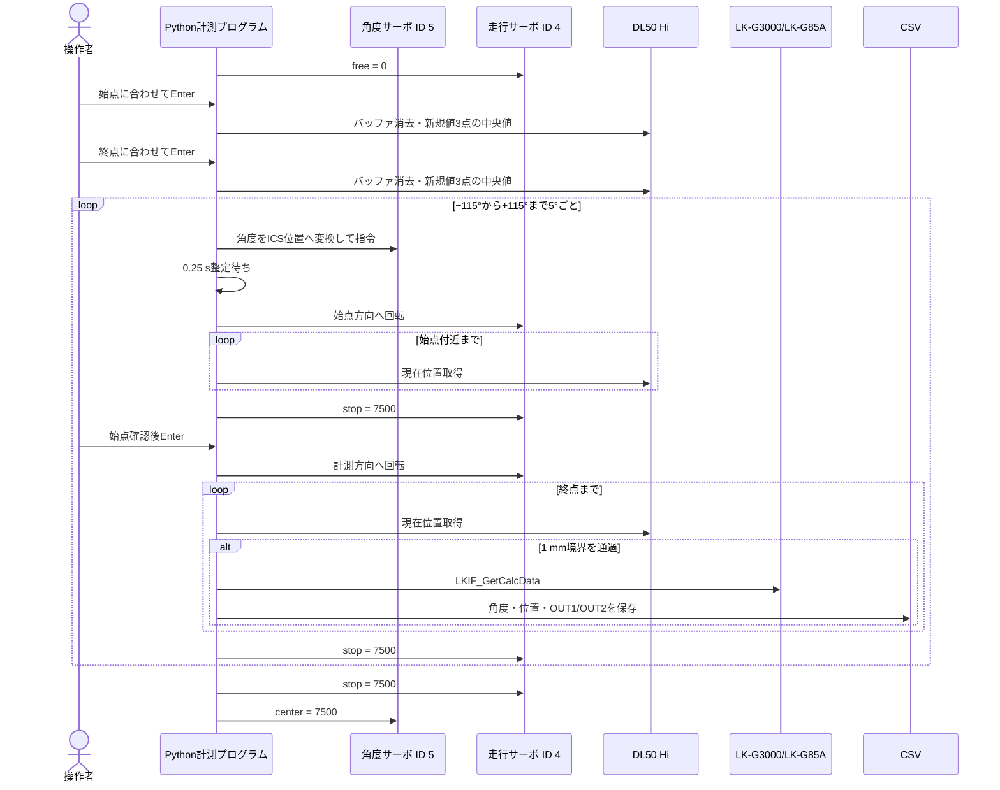

# 配管内面レーザ計測時の通信・サーボ制御資料

## 1. 目的

本資料は、KEYENCE LK-G85Aで配管内面を計測したときの、次の仕組みを再現できる形で整理したものである。

- LK-G85Aの変位値をPCへ取り込む方法
- SICK DL50 Hiで配管軸方向の位置を取得する方法
- KRS-9004系サーボでレーザ照射角度を変更する方法
- 連続回転サーボで計測機構を配管軸方向へ移動する方法
- 角度方向・軸方向の走査とCSV保存の流れ

この計測は、**LK-G85Aを一定時間ごとに読む方式ではなく、DL50で検出した移動距離が1 mm進むたびにLK-G85Aを1回読む方式**である。

## 2. システム構成



### 各機器の役割

| 機器 | 役割 | PCとの接続 |
|---|---|---|
| KEYENCE LK-G85A | 配管内面までの変位を計測 | LK-G3000とKEYENCE DLLを介したUSB接続 |
| KEYENCE LK-G3000 | LK-G85Aの演算・OUT1/OUT2出力 | USB |
| SICK DL50 Hi | 計測機構の配管軸方向位置を計測 | RS-422→USB変換、実験時COM10 |
| レーザ角度サーボ | LK-G85Aの照射方向を変更 | ICS、ID 5 |
| 走行用連続回転サーボ | 計測機構を始点・終点間で移動 | ICS、ID 4 |

> **注意:** USB-RS-422変換器の端子番号やA/B線の色はソースコードには残っていない。再配線時は、使用した変換器とDL50 Hiの取扱説明書でTX/RX極性を確認すること。

## 3. LK-G85Aとの通信

### 3.1 通信経路

LK-G85AはPCのCOMポートへ直接つないでいない。通信経路は次のとおりである。

```text
LK-G85Aセンサヘッド
  → LK-G3000コントローラ
  → USB
  → KEYENCE USBドライバ
  → LkIF.dll
  → Python ctypes
```

PC側では `LkIF.dll` を `ctypes.WinDLL` で読み込み、次のDLL関数を呼び出している。

```python
LKIF_GetCalcData(OUT1へのポインタ, OUT2へのポインタ)
```

受信構造体は次の2要素である。

```text
FloatResult : 状態コード（32 bit整数）
Value       : 変位値（32 bit浮動小数点数、mm）
```

`FloatResult == 0` の場合だけ `Value` を有効な計測値としてCSVへ保存する。

| 状態コード | プログラム上の表示 | 意味 |
|---:|---|---|
| 0 | `VALID` | 有効値 |
| 1 | `RANGEOVER_N` | 負側レンジオーバー |
| 2 | `WAITING` | 待機中 |
| 3 | `RANGEOVER_P` | 正側レンジオーバー |
| 4 | `ALARM` | アラーム |

### 3.2 必要ファイル

KEYENCE配布物から次のDLLを `sensor_logger` フォルダへ置く。

```text
sensor_logger/
  LkIF.dll
  KeyUsbDrv.dll
```

これらは再配布条件の関係からGitHubには含めていない。PythonとDLLの32/64 bitを一致させる必要がある。

### 3.3 単体確認

```powershell
cd sensor_logger
python lk_probe.py
```

正常時は、少なくとも `LKIF_GetCalcData: found` と、OUT1/OUT2の値および `VALID` が表示される。

## 4. DL50 Hiとの通信

DL50 Hiは配管内面形状を測るセンサではなく、**軸方向位置を決める基準センサ**として使った。

### 4.1 実験時の通信条件

| 項目 | 設定 |
|---|---|
| 物理層 | RS-422 |
| PC側ポート | COM10（実験時。PCにより変化する） |
| ボーレート | 115200 bps |
| データ長 | 7 bit |
| パリティ | Even |
| ストップビット | 1 bit |
| 使用モード | Continuous出力 |

Pythonでは `pyserial` を使用した。

### 4.2 連続出力データ

実験時に安定して取得できたデータ例は次のとおりである。

```text
+0023993\r\n
```

末尾から符号付き7桁の整数を抽出し、10で割ってmmへ変換する。

```text
+0023993 → 23993 / 10 = 2399.3 mm
```

読み取りでは、受信バッファに複数行ある場合に**最新の完全な行**を使用する。始点・終点を記録するときは古いデータを使わないよう、バッファを消去した後に新しい有効値を3個取得し、中央値を採用する。

### 4.3 コマンドによる確認

診断用プログラムでは次のASCIIフレームを送信できる。

| 操作 | 送信バイト | 表現 |
|---|---|---|
| 現在値要求 | `02 30 31 30 37 03` | `<STX>0107<ETX>` |
| Continuous停止 | `02 30 35 30 32 30 30 03` | `<STX>050200<ETX>` |
| Continuous開始 | `02 30 35 30 32 30 31 03` | `<STX>050201<ETX>` |

単体確認例:

```powershell
python dl50_probe.py --port COM10 --baud 115200 --bytesize 7 --parity E --read-idle
```

必要に応じて `--request`、`--continuous-on`、`--continuous-off` を使う。

## 5. サーボの制御方法

### 5.1 接続と通信条件

2台のサーボはKONDO Dual USB Adapter HSを介し、同じICSバス上でIDを分けて制御した。

| 項目 | 設定 |
|---|---|
| 実験時COMポート | COM8 |
| ボーレート | 115200 bps |
| データ長 | 8 bit |
| パリティ | Even |
| ストップビット | 1 bit |
| レーザ角度サーボ | ID 5 |
| 走行用連続回転サーボ | ID 4 |

ICS ManagerがCOMポートを開いているとPythonから開けないため、計測前にICS Managerを終了する。

### 5.2 ICS位置指令

位置指令は3 byteで生成する。

```text
byte 0 = 0x80 OR (servo_id AND 0x1F)
byte 1 = (position >> 7) AND 0x7F
byte 2 = position AND 0x7F
```

送信前に入力バッファを消去し、3 byteを送信後、約12 ms待って最大16 byteの応答を読む。送信値と応答値は端末へ16進表示する。

### 5.3 レーザ角度サーボ（ID 5）

角度は次の線形変換でICS位置へ変換した。

\[
p(\theta)=p_{\min}+\frac{\theta-\theta_{\min}}
{\theta_{\max}-\theta_{\min}}(p_{\max}-p_{\min})
\]

設定値は次のとおりである。

| 角度 | ICS位置 |
|---:|---:|
| −135° | 3500 |
| 0° | 7500 |
| +135° | 11500 |

実際の配管計測では −115～+115°を5°刻みで使用した。

| 指令 | ICS位置 | 送信例（hex） |
|---|---:|---|
| −115° | 4093 | `85 1F 7D` |
| 0° | 7500 | `85 3A 4C` |
| +115° | 10907 | `85 55 1B` |

各角度の指令後、機械的な整定を待つため0.25 s待機してから軸方向走査を開始した。

### 5.4 走行用連続回転サーボ（ID 4）

連続回転設定のサーボでは、ICSの「位置」値を回転方向・速度指令として使った。

| 動作 | ICS位置 | 送信例（hex） | 備考 |
|---|---:|---|---|
| 計測方向へ走行 | 7350 | `84 39 36` | 代表実験で使用 |
| 停止・中立 | 7500 | `84 3A 4C` | 必ず停止時に送信 |
| 始点へ戻る | 11500 | `84 59 6C` | 代表実験で使用 |
| フリー | 0 | `84 00 00` | 始点・終点を手で合わせるときに使用 |

7350と11500のどちらが実機上の正転・逆転になるかは、サーボの取付方向に依存する。

## 6. 自動走査の処理手順



### 距離トリガの計算

始点DL50値を \(x_0\)、現在値を \(x\)、終点方向の符号を \(s\in\{-1,+1\}\) とすると、進行距離は次式で求める。

\[
d=s(x-x_0)
\]

軸方向刻みを \(\Delta x=1\ \mathrm{mm}\) としたとき、到達した整数インデックスは次のとおりである。

\[
k=\left\lfloor\frac{d}{\Delta x}\right\rfloor
\]

前回の記録インデックスより \(k\) が進んだ時点でLK-Gを1回読み、CSVに保存する。このため、サーボ速度のばらつきがあっても、時間ではなくDL50の実測位置を基準にサンプリングできる。

ただし、1回のループで2 mm以上進むと中間点は補間せず、到達した最新位置だけを保存する。CSVの `skipped_targets` と `sample_note` で飛び越しを確認できる。

## 7. 代表実験の設定と実績

`pipe154_auto_scan_m115_115.csv` と実行スクリプトから確認できた条件は次のとおりである。

| 項目 | 値 |
|---|---:|
| 角度範囲 | −115～+115° |
| 角度刻み | 5° |
| 角度数 | 47 |
| 軸方向刻み | 1 mm |
| 軸方向計測範囲 | 約732 mm |
| 走査時ID 4指令 | 7350 |
| 戻り時ID 4指令 | 11500 |
| 保存点数 | 22,053点 |
| CSV上の計測時間 | 約1時間09分53秒 |
| 計測日時 | 2026-06-07 16:34～17:44 |

実行例:

```powershell
cd sensor_logger
python auto_angle_wheel_scan_logger.py `
  --dl50-port COM10 `
  --servo-port COM8 `
  --laser-id 5 `
  --wheel-id 4 `
  --angle-start -115 `
  --angle-end 115 `
  --angle-step 5 `
  --step-mm 1 `
  --wheel-forward-speed 7350 `
  --wheel-return-speed 11500 `
  --csv pipe154_auto_scan_m115_115.csv
```

## 8. 保存データ

主なCSV列は次のとおりである。

| 列 | 内容 |
|---|---|
| `pc_time` | PC時刻 |
| `elapsed_s` | 計測開始からの経過時間 |
| `angle_group` | 角度グループ番号 |
| `angle_deg` | 指令角度 |
| `laser_position` | ID 5へ送ったICS位置 |
| `wheel_position` | ID 4へ送ったICS位置 |
| `trigger_index` | 距離トリガ番号 |
| `target_delta_mm` | 本来記録する軸方向距離 |
| `dl50_hi_mm` | DL50の実測位置 |
| `dl50_progress_mm` | 始点からの実測進行距離 |
| `dl50_raw` | DL50の受信文字列 |
| `lk_out1_mm`, `lk_out2_mm` | LK-G3000の演算値 |
| `lk_out1_status`, `lk_out2_status` | LK値の状態 |
| `skipped_targets` | ループ間で飛び越した距離点数 |
| `sample_note` | 計測方向や飛び越し情報 |

古い実験CSVには `pass_index`、`motion_direction` がない。解析時はCSVヘッダを確認すること。

## 9. 計測前チェック

1. LK-G3000とPCをUSB接続し、LK-G85Aのレーザが測定対象を捉えていることを確認する。
2. `LkIF.dll` と `KeyUsbDrv.dll` を `sensor_logger` に置く。
3. `python lk_probe.py` でOUT1/OUT2が `VALID` になることを確認する。
4. DL50 HiとUSB-RS-422変換器を接続し、デバイスマネージャでCOM番号を確認する。
5. `dl50_probe.py` で符号付き7桁の連続値が得られることを確認する。
6. Dual USB Adapter HSのCOM番号と、サーボID 5・ID 4を確認する。
7. ICS Managerを終了する。
8. 角度サーボを0°付近で単体確認し、機構へ干渉しないことを確認する。
9. 走行サーボへ7500を送り、確実に停止することを確認する。
10. 非常時にキー入力またはCtrl+Cで止められる位置にPCを置く。

## 10. 停止処理と安全上の注意

- 走行中に何かキーを押すと、その区間を停止する。
- Ctrl+Cまたは正常終了時には、ID 4へ7500を送って停止する。
- 終了時にはID 5へ7500を送り、レーザ角度を中央へ戻す。
- 始点へ戻る処理には最大時間を設け、無限に押し続けないようにしている。
- DL50値が想定と逆方向へ変化した場合は警告を表示する。
- ソフトウェア停止だけに依存せず、電源遮断手段と機械的な終端を用意すること。

## 11. 再現時に注意する点

- COM8、COM10は実験時の値であり、USBを差す位置やPCによって変わる。
- LK-G85AとDL50の読み取りはハードウェア同期ではない。DL50が距離境界を越えた後に、PCからLK-Gを読み出している。
- ID 5の角度はICS位置との線形換算値であり、取付誤差、バックラッシ、センサ光軸のずれを含む。高精度化には実角度校正が必要である。
- ID 4は連続回転サーボなので、指令値だけから絶対位置は分からない。位置決定はDL50に依存する。
- DL50の値が1ループ中に複数mm進むと欠測点が生じる。速度低下、読み取り周期短縮、往復計測またはハードウェアトリガ化が改善候補となる。
- 実測CSVでは角度ごとに始点確認を行っており、この操作時間も総計測時間に含まれる。

## 12. 関連ソース

| ファイル | 内容 |
|---|---|
| `sensor_logger/sensor_logger.py` | LK-G DLLラッパ、DL50通信・パーサ |
| `sensor_logger/lk_probe.py` | LK-G単体確認 |
| `sensor_logger/dl50_probe.py` | DL50通信条件・コマンド確認 |
| `sensor_logger/krs9004_angle_control.py` | ID 5の角度制御確認 |
| `sensor_logger/krs9004_dual_usb_control.py` | ICS位置指令と連続回転確認 |
| `sensor_logger/auto_angle_wheel_scan_logger.py` | 角度・走行・距離トリガ・CSV保存の統合処理 |
| `sensor_logger/run_pipe_experiment_154mm.py` | 代表実験の実行条件 |
| `sensor_logger/README_LK_G_MEASUREMENT.md` | 計測ツール全体の使い方 |

