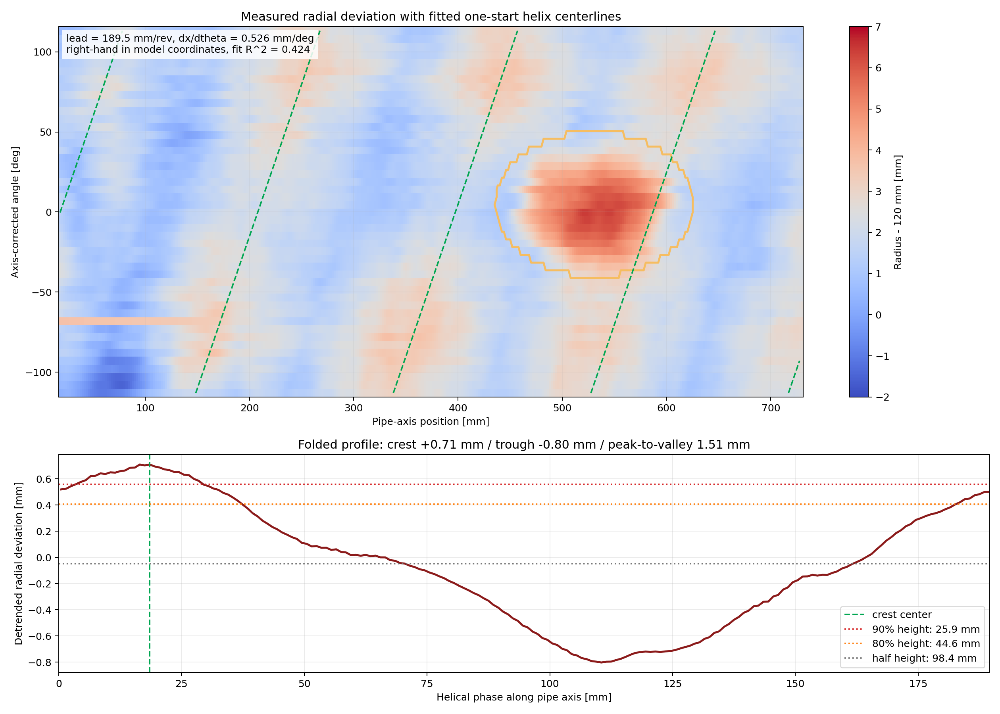

# LK-G85Aセンサ値からの螺旋畝推定

軸補正済みのLK-G85A配管内面データから、1条螺旋のリード、巻き方向、位相、高さ、幅を推定する解析です。

## 対象データ

- 測定点数: 22,052点
- 角度トラック: 47本
- 軸方向測定範囲: 約0～732 mm
- 補正後角度範囲: 約-113.5～+113.4 deg
- 基準配管半径: 120 mm

生CSVは実験データ管理と容量の都合からGitHubに含めません。`estimate_helical_ridge.py` の `--input` に軸補正済みCSVを指定します。

## 推定方法

1. 角度ごとの半径平均を引き、配管の楕円・偏心成分を抑えます。
2. 軸方向位置ごとの平均を引き、全角度に共通する軸方向変形を抑えます。
3. 分岐開口中心（軸方向約531 mm、角度約5 deg）の周囲95 mmを除外します。
4. 次式の右巻き・左巻きを、リード60～250 mm/回転、0.5 mm刻みで比較します。

```text
phase = 2*pi*x/lead +/- theta
```

5. 螺旋断面が正弦波に限定されないよう4次高調波まで最小二乗近似し、決定係数が最大となる条件を採用します。
6. 推定した螺旋位相で全測定点を1周期へ折り重ね、中央値波形から高さと幅を求めます。

## 現在の実測結果

| 項目 | 推定値 |
|---|---:|
| 1回転当たりのリード | 189.5 mm/rev |
| 角度1 deg当たりの軸方向移動 | 0.526 mm/deg |
| 巻き方向 | モデル座標で右ねじ方向 |
| 決定係数 | 0.424 |
| 真上0 degでの頂部位相 | 約18.5 mm + 189.5 mm × n |
| 頂部の平均面からの偏差 | +0.71 mm |
| 谷部の平均面からの偏差 | -0.80 mm |
| 山谷差 | 1.51 mm |
| 高さ90%以上の頂部幅 | 25.9 mm |
| 高さ80%以上の幅 | 44.6 mm |
| 半値幅 | 98.4 mm |

角度範囲を分割した推定でもリードは約186.5～191.5 mmに収まりました。約100 mmという値は同じ頂部が1回転して戻るリードではなく、山から谷までの半周期（189.5 / 2 = 94.75 mm）に近いと考えられます。



## 実行方法

```powershell
python -m pip install -r .\requirements_research.txt
python .\sensor_logger\pipe_model\estimate_helical_ridge.py `
  --input .\sensor_logger\pipe154_auto_scan_m115_115_point_cloud_axis_corrected.csv
```

出力:

- `output/helical_ridge_estimation.json`: 数値結果
- `output/helical_ridge_estimation.png`: 展開図、推定中心線、折り重ね断面

## 注意点

- 推定値は測定範囲内の代表値であり、配管全長で一定とは限りません。
- 「頂部幅」は使用する高さしきい値で変わります。既知の約30 mmは高さ90%以上の幅と整合します。
- 山谷差1.51 mmと、平均面から頂部までの0.71 mmを混同しないでください。
- 分岐開口を除外しない場合、開口の大きな半径変化が螺旋推定を歪めます。

## 推定値から生成した配管モデル

`build_ridged_pipe_model.py` は上記JSONを読み、内径240 mmの基準円筒へ、90%幅・80%幅・半値幅を通る連続断面の1条螺旋を360°全周に展開します。肉厚は5 mmです。未測定部分に実測ノイズをコピーするのではなく、測定範囲から得た代表的な螺旋形状を全周へ一般化します。

```powershell
python .\sensor_logger\pipe_model\build_ridged_pipe_model.py
```

- `output/pipe_wall_5mm_full360_helix_estimated.stl`: シミュレータ用の全周・閉じた肉厚モデル
- `output/pipe_inner_full360_helix_estimated.stl`: 全周の配管内面モデル
- `output/pipe_full360_helix_estimated.json`: 使用した寸法と出力情報
- `output/pipe_full360_helix_estimated_preview.png`: 形状確認図
